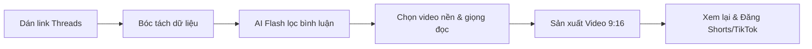

# ThreadCut 🎬

[](https://github.com/ChienHayCuoi/ThreadCut/releases/latest)
[](LICENSE)
[](https://github.com/ChienHayCuoi/ThreadCut/releases/latest)

> **ThreadCut** là ứng dụng desktop (Electron + React + TypeScript) tự động hóa quy trình sản xuất **Video ngắn 9:16 (TikTok, YouTube Shorts, Facebook Reels)** từ bài viết và bình luận trên mạng xã hội **Threads**.

---

## 📥 Tải về ứng dụng (Downloads)

Nhấp vào liên kết bên dưới để tải phiên bản mới nhất cho hệ điều hành của bạn:

| Hệ điều hành | Định dạng | Tải về |
| :--- | :--- | :--- |
| **Windows** | `.exe` (Setup 64-bit) | [⬇️ **Tải bản Windows (.exe)**](https://github.com/ChienHayCuoi/ThreadCut/releases/latest) |
| **Linux** | `.AppImage`, `.deb` | [⬇️ **Tải bản Linux**](https://github.com/ChienHayCuoi/ThreadCut/releases/latest) 
---

## ✨ Tính năng nổi bật

- 🕷️ **Cào dữ liệu Threads tự động (Crawler)**:
  - Bóc tách nội dung bài đăng gốc, tác giả, lượt like/tim và toàn bộ bình luận trực tiếp từ link bài viết Threads.
  - Phân tích và chuyển đổi chính xác số lượng tương tác (like, tim dạng số nguyên hoặc định dạng `K`, `M`).

- 🧠 **Chấm điểm & Lọc bình luận bằng Google Gemini Flash (AI)**:
  - Tích hợp model `gemini-3.5-flash` phân tích ngữ cảnh, ưu tiên tương tác cao nhất và chọn lọc các bình luận viral, hài hước hoặc sâu sắc nhất.
  - Cho phép người dùng trực tiếp chỉnh sửa nội dung hoặc tick/bỏ chọn từng bình luận trước khi sản xuất video.

- 🎙️ **Thuyết minh tự nhiên với Edge-TTS**:
  - Tích hợp giọng đọc AI tiếng Việt mượt mà, truyền cảm.
  - Hỗ trợ tùy chỉnh tốc độ nói phù hợp với nhịp độ video ngắn.
  - Trích xuất chính xác timestamp từng từ (word-level timestamps) để đồng bộ âm thanh và phụ đề chuẩn mili-giây.

- 🎨 **Hiệu ứng chữ nhảy Karaoke & Card Threads**:
  - Tự động dựng hình thẻ bài viết (Card) chuẩn phong cách Threads, hiển thị mượt mà trên nền video.
  - Tạo phụ đề Karaoke động bắt mắt (`.ass`), highlight màu nổi bật theo từng từ đang được đọc.

- 📱 **Sản xuất Video chuẩn 9:16 & Live Preview**:
  - Hỗ trợ tải lên video nền tùy biến từ máy tính (Gameplay Minecraft, Subway Surfers, ASMR, vlog...).
  - Tự động crop căn giữa chuẩn tỉ lệ dọc 9:16 (1080x1920) và loop video nền theo thời lượng âm thanh.
  - Tích hợp khung xem trước (Live Preview Mockup Smartphone) hiển thị video nền và bố cục trực quan trước khi xuất.
  - Trình phát video tích hợp sẵn cho phép xem lại video thành phẩm ngay trong ứng dụng và mở nhanh thư mục lưu trữ.

---

## 🛠️ Công nghệ sử dụng

| Lớp | Công nghệ |
| :--- | :--- |
| **Desktop Framework** | [Electron](https://www.electronjs.org/) + [Electron-Vite](https://electron-vite.org/) |
| **Frontend** | [React 19](https://react.dev/), [TypeScript](https://www.typescriptlang.org/), [Vite](https://vitejs.dev/) |
| **AI Processing** | [@google/genai](https://github.com/google-gemini/generative-ai-js) (`gemini-3.5-flash`) |
| **Text-to-Speech** | [node-edge-tts](https://github.com/schroffl/node-edge-tts) |
| **Video Engine** | [FFmpeg](https://ffmpeg.org/) (hỗ trợ binary bundle hoặc hệ thống) + [fluent-ffmpeg](https://github.com/fluent-ffmpeg/node-fluent-ffmpeg) |

---

## 🚀 Cài đặt & Khởi chạy

### 1. Yêu cầu hệ thống
- **Node.js**: Phiên bản 18+ (khuyên dùng Node 20 hoặc 22 LTS).
- **Trình quản lý gói**: `yarn` hoặc `npm`.
- **FFmpeg**: Cài đặt trên hệ điều hành (`sudo apt install ffmpeg` trên Linux hoặc `brew install ffmpeg` trên macOS) hoặc đặt binary vào thư mục `resources/bin/`.

### 2. Cài đặt dependencies

```bash
# Sử dụng yarn (khuyên dùng)
yarn install

# Hoặc sử dụng npm
npm install
```

### 3. Cấu hình ban đầu
Mở ứng dụng và nhấp vào biểu tượng **⚙️ Cài đặt** ở góc trên bên phải để thiết lập:
- **Google Gemini API Key**: Lấy API Key miễn phí từ [Google AI Studio](https://aistudio.google.com/).
- **Giọng đọc mặc định**: Chọn giọng nữ (Dun) hoặc giọng nam (Chin).
- **Thư mục lưu video**: Chọn nơi lưu trữ video sau khi render (mặc định lưu vào thư mục `Videos/ThreadCut` của người dùng).

### 4. Chạy chế độ Development

```bash
# Khởi chạy ứng dụng ở chế độ dev
yarn dev

# Hoặc với npm
npm run dev
```

### 5. Đóng gói ứng dụng (Build)

```bash
# Kiểm tra types
yarn typecheck

# Đóng gói ứng dụng cho hệ điều hành hiện tại
yarn build

# Đóng gói bộ cài đặt theo từng hệ điều hành:
yarn build:linux    # Linux (.AppImage, .deb)
yarn build:mac      # macOS (.dmg)
yarn build:win      # Windows (.exe)
```

---

## 📖 Hướng dẫn sử dụng



1. **Bước 1**: Sao chép link bài viết Threads bất kỳ (ví dụ: `https://www.threads.com/@username/post/...`).
2. **Bước 2**: Dán link vào ô nhập liệu và bấm **"Bắt đầu bóc tách & Lọc AI"**.
3. **Bước 3**: Xem kết quả bài viết và danh sách các bình luận viral được Gemini Flash tuyển chọn:
   - Tùy chỉnh tick chọn/bỏ chọn các bình luận muốn đưa vào video.
   - Chỉnh sửa lại câu từ nếu muốn tối ưu hóa kịch bản đọc.
4. **Bước 4**: Tại phần **Video nền (9:16)**, bấm **"Chọn file"** để tải lên video nền cá nhân (gameplay, video chill, v.v.). Bạn có thể xem trước chuyển động ngay trên khung điện thoại bên phải.
5. **Bước 5**: Chọn tốc độ đọc phù hợp và bấm **"🚀 Bắt đầu sản xuất Video 9:16"**.
6. **Bước 6**: Sau khi render hoàn tất, chuyển sang tab **"🎬 Video xuất"** để xem video trực tiếp hoặc bấm **"📂 Mở thư mục video"** để nhận file thành phẩm.

---

## 📂 Cấu trúc thư mục

```text
ThreadCut/
├── resources/              # Tài nguyên tĩnh, template, ffmpeg binary
├── src/
│   ├── main/               # Tiến trình chính Electron (Main Process)
│   │   ├── ipc/            # Bộ điều phối sự kiện IPC giữa Renderer và Main
│   │   ├── modules/
│   │   │   ├── ai/         # Gemini AI Service (chấm điểm & chọn lọc bình luận)
│   │   │   ├── card/       # Render card hình ảnh bài viết và bình luận
│   │   │   ├── crawler/    # Module bóc tách dữ liệu bài viết Threads
│   │   │   ├── settings/   # Quản lý cấu hình người dùng
│   │   │   ├── tts/        # Edge-TTS Service & trích xuất Word Timestamps
│   │   │   └── video/      # FFmpeg Pipeline, tạo phụ đề .ass & render video 9:16
│   │   └── index.ts        # Entry point của Electron app
│   ├── preload/            # Preload script & API context bridge an toàn
│   ├── renderer/           # Giao diện người dùng React (Renderer Process)
│   │   └── src/
│   │       ├── App.tsx     # Giao diện chính và luồng xử lý tương tác
│   │       └── main.tsx    # Mount React Application
│   └── shared/             # Định nghĩa Type TypeScript dùng chung (types.ts)
├── electron.vite.config.ts # Cấu hình Vite & Electron bundling
├── package.json
└── README.md
```

---

## ⚖️ Giấy phép

Dự án được phân phối dưới giấy phép **MIT License**.
